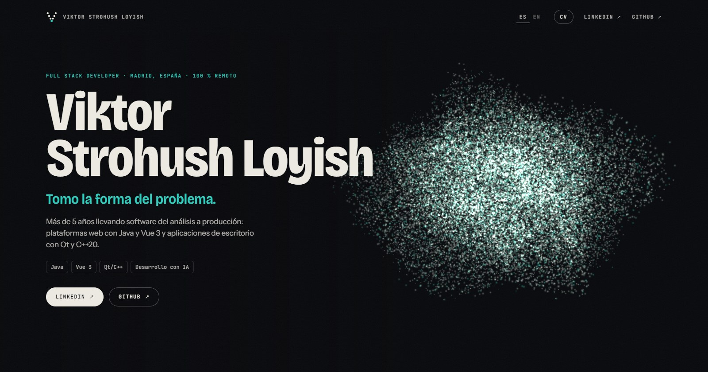

# Viktor Strohush Loyish · Portfolio

[](https://github.com/byVik/portfolio/actions/workflows/ci.yml)

**Publicado en [viktorstrohush.dev](https://viktorstrohush.dev/?lang=es)** · [Read in English](README.md)

Un portfolio 3D interactivo construido sobre una idea: **«Tomo la forma del problema»**. Al hacer scroll, 36 000
puntos se reorganizan en una forma distinta para cada etapa de mi carrera.

[](https://viktorstrohush.dev/?lang=es)

|                            Retícula                             |                                 Globo                                 |                                  Órbita                                  |                              Hexágono                              |
| :-------------------------------------------------------------: | :-------------------------------------------------------------------: | :----------------------------------------------------------------------: | :----------------------------------------------------------------: |
|  |  |  |  |
|                       El ruido, ordenado                        |                 Pedidos en los aeropuertos de España                  |                   Agentes de IA alrededor de un núcleo                   |                       Arquitectura hexagonal                       |

## Qué se puede hacer

- **Scroll**: transforma una forma en la siguiente.
- **Ratón**: los puntos se apartan del cursor; **arrastrar** gira la forma; un **clic** lanza una onda.
- **Antes / Después** (Volinga): devuelve a la escena el código muerto y lo vuelve a podar. Cae el 80 % de los puntos.
- **Ejecutar pipeline**: un pulso recorre tests, build, instalador y firma, y va marcando cada etapa.
- **¿Qué forma tiene tu problema?** Escribes una palabra y los puntos la dibujan.
- **ES / EN**: todo el contenido en dos idiomas. `?lang=en` abre directamente en inglés.
- **Juegos**: una ficha por juego con vídeo de partida, estado y, cuando está publicado, enlaces.
- **CV**: modo lectura en plano, imprimible y con PDF descargable. `?cv=1` lo abre directamente.

Se degrada a propósito: sin WebGL el contenido sigue siendo legible, con `prefers-reduced-motion` la escena se calma,
y en equipos lentos baja sola el número de puntos.

## Una forma por capítulo

| Sección       | Forma    | Por qué                                             | Lo que se mueve              |
| ------------- | -------- | --------------------------------------------------- | ---------------------------- |
| Inicio        | Nube     | El ruido del que parte todo                         |                              |
| Perfil        | Retícula | El ruido, ordenado                                  | Señales entre nodos          |
| Volinga       | Armazón  | Cae el 80 % de los puntos: el código que sobraba    |                              |
| Volinga Suite | Plató    | Pared de paneles y cámara: la industria audiovisual |                              |
| Pipeline      | Pipeline | Tests → build → instalador → firma                  | Paquetes cruzando las etapas |
| Arquimea      | Globo    | Pedidos en casi todos los aeropuertos de España     | Vuelos desde Madrid          |
| Móvil         | Pelota   | La app del Mutua Madrid Open                        |                              |
| IA            | Órbita   | Agentes girando alrededor de un núcleo              | Los agentes                  |
| OrderFlow     | Hexágono | Arquitectura hexagonal                              | Eventos por los adaptadores  |
| Juegos        | Mando    | Fuera del trabajo también hago juegos               | Pulsaciones en los botones   |
| Stack         | Capas    | El stack, apilado                                   | Peticiones entre capas       |
| Contacto      | Tu texto | Escribes tu problema y los puntos lo dibujan        |                              |

## Cómo está hecho

El código está organizado por dominio, no por tipo de archivo:

```
src/
  app/        Composición de la página, cabecera y tokens de la identidad visual
  content/    El CV, sus dos idiomas y el idioma activo
  scene/      La escena 3D
    model/      Lógica pura y testeada: formas, recorridos, scroll, rotación, calidad
    engine/     Three.js: renderizado y shaders
    ui/         Vue: lienzo, gestos, HUD y el puente con el resto de la página
  story/      Las secciones del recorrido y sus controles
  reading/    Modo lectura
  shared/     Utilidades sin dominio
specs/        Especificaciones
scripts/      Exportación de PDF, imagen de vista previa y capturas del README
```

- **Núcleo puro.** Todo lo que hay en `scene/model` es TypeScript sin Three.js, Vue ni DOM, y tiene tests unitarios.
- **Una sola puerta a Three.js.** Solo lo importa `scene/engine`, y el resto de la página habla con la escena por un
  único puente, `scene/ui/controls.ts`.
- **Las fronteras se comprueban, no se acuerdan.** ESLint hace fallar el CI si Three.js se importa desde otro sitio
  o si un dominio entra en otro con rutas relativas.
- **Sin librerías de UI ni de animación.** Vue 3, TypeScript, Three.js y CSS y GLSL escritos a mano.
- **Primero el texto.** Three.js se carga en diferido: el contenido se pinta antes de que llegue la escena.

## Spec Driven Development

El comportamiento se escribe primero en [`specs/`](specs/README.md) como requisitos numerados. Los tests citan el id
del requisito que comprueban, por ejemplo `describe('ESC-07 · calidad adaptativa')`, y el código llega al final. Las
reglas para trabajar en el repositorio, con o sin agentes de IA, están en [`AGENTS.md`](AGENTS.md).

Specs, comentarios e historial de commits están en español; los identificadores, en inglés.

## Stack

Vue 3 (Composition API) · TypeScript · Three.js · Vite · Vitest · ESLint · Prettier · GitHub Actions ·
Cloudflare Workers

## Arrancarlo en local

```bash
npm install
npm run dev            # servidor de desarrollo
npm test               # tests unitarios
npm run lint           # ESLint
npm run format         # Prettier
npm run build          # comprobación de tipos + build estático en dist/
npm run export         # regenera los PDF del CV, la vista previa y las capturas del README (necesita Edge o Chrome)
```

## Editar el contenido

- Un texto: `src/content/es.ts` y `src/content/en.ts`.
- Un enlace o una tecnología: `src/content/shared.ts`.
- Un juego: ver [specs/05-juegos.md](specs/05-juegos.md).
- Una sección nueva: un capítulo en los dos idiomas y una escena con el mismo `id` en `src/scene/model/scenes.ts`.
  Un test falla si no coinciden.

Después de cambiar el contenido, `npm run export` actualiza los PDF.

## Despliegue

El sitio se sirve en [viktorstrohush.dev](https://viktorstrohush.dev) desde Cloudflare Workers como sitio estático
(`wrangler.jsonc`): sin servidor ni código en el borde, solo los archivos de `dist/`. Cada push a `main` lo publica.

```bash
npm run deploy         # build + wrangler deploy, para publicar a mano (antes, `npx wrangler login`)
```

La URL pública vive en `.env` (`VITE_SITE_URL`); de ella salen la dirección canónica y la imagen de vista previa que
se muestra al compartir el enlace. `public/_headers` fija la caché de los archivos con hash y de los vídeos.

## Identidad visual

| Token      | Valor     | Uso                                               |
| ---------- | --------- | ------------------------------------------------- |
| `--ink`    | `#07080b` | Fondo                                             |
| `--bone`   | `#edeae2` | Texto y puntos cálidos                            |
| `--cold`   | `#25a585` | Puntos fríos (profundidad)                        |
| `--signal` | `#2ccfc0` | Único acento: etiquetas, cifras y lo que se mueve |

- **Bricolage Grotesque** condensada para titulares, **Instrument Sans** para el texto y **JetBrains Mono** para
  etiquetas y datos.
- La escena lee los colores de estos mismos tokens: cambiarlos en `src/app/styles.css` cambia también los puntos.
