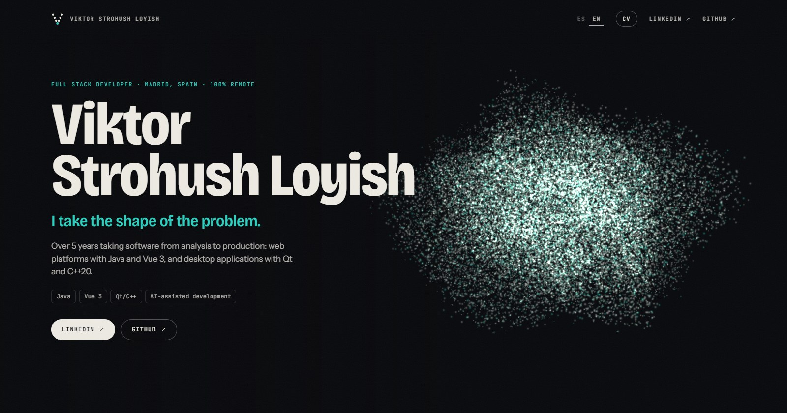
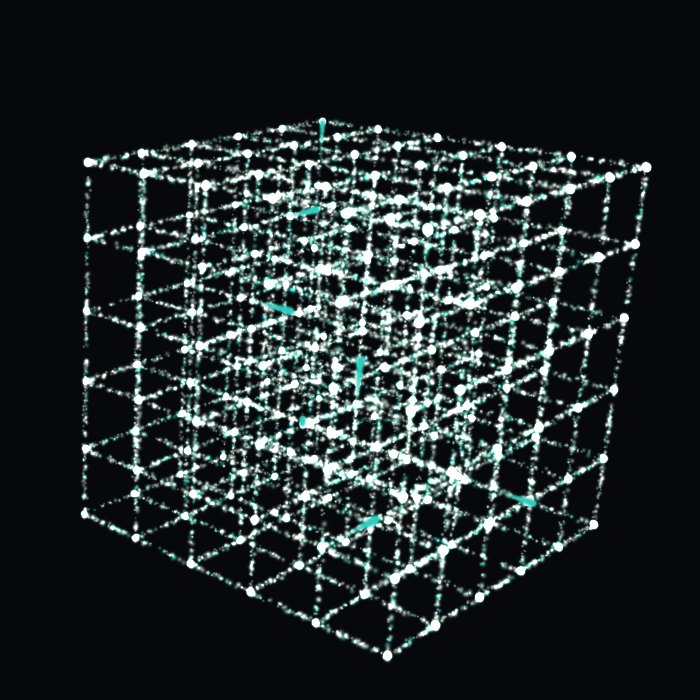
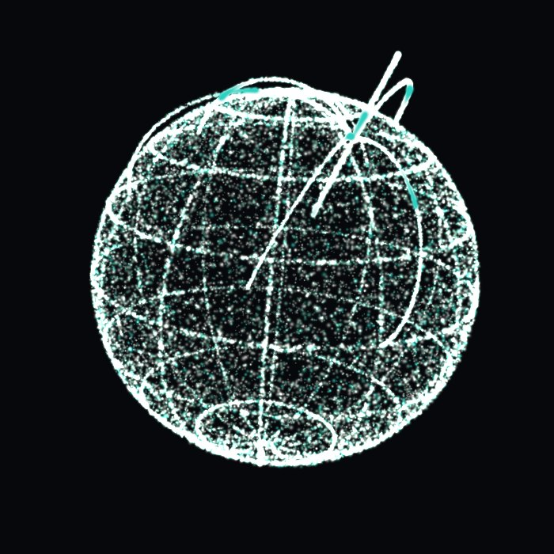
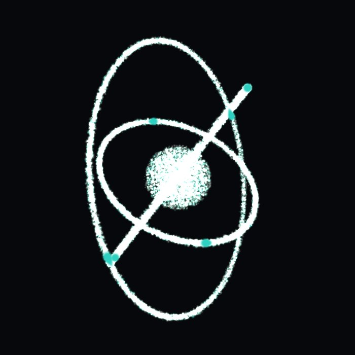
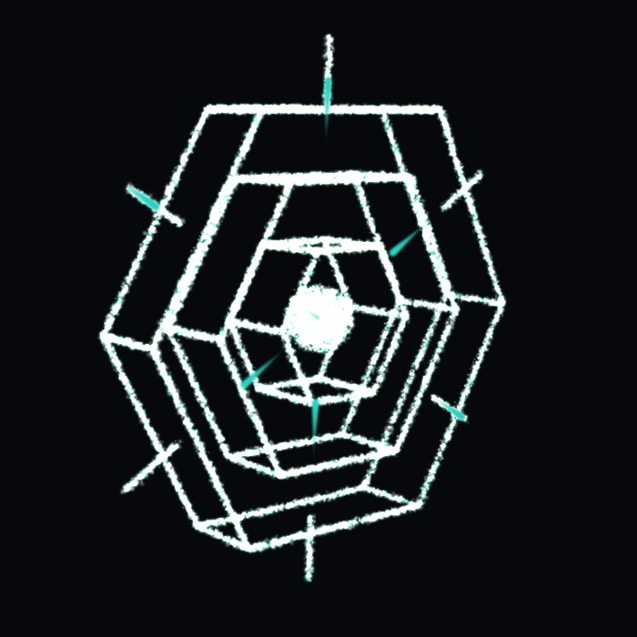

# Viktor Strohush Loyish · Portfolio

[](https://github.com/byVik/portfolio/actions/workflows/ci.yml)

**Live at [viktorstrohush.dev](https://viktorstrohush.dev/?lang=en)** · [Leer en español](README.es.md)

An interactive 3D portfolio built around one idea: **“I take the shape of the problem.”** As you scroll, 36,000
points rearrange into a different shape for each stage of my career.

[](https://viktorstrohush.dev/?lang=en)

|                          Lattice                           |                                Globe                                |                             Orbit                             |                          Hexagon                           |
| :--------------------------------------------------------: | :-----------------------------------------------------------------: | :-----------------------------------------------------------: | :--------------------------------------------------------: |
|  |  |  |  |
|                    Noise, put in order                     |                   Orders across Spain’s airports                    |                    AI agents around a core                    |                   Hexagonal architecture                   |

## What you can do

- **Scroll** to morph one shape into the next.
- **Move the mouse** and the points step aside; **drag** to rotate the shape; **click** for a shockwave.
- **Before / After** (Volinga): bring the dead code back into the scene, then prune it again. 80% of the points fall.
- **Run pipeline**: a pulse travels through tests, build, installer and signing, ticking each stage off.
- **What shape is your problem?** Type a word and the points draw it.
- **ES / EN**: all the content in two languages. `?lang=en` opens straight in English.
- **Games**: a card per game with gameplay video, status and, once published, links.
- **CV**: a plain reading mode, printable, with a downloadable PDF. `?cv=1` opens it directly.

It degrades on purpose: without WebGL the content is still fully readable, `prefers-reduced-motion` calms the scene,
and slower machines automatically get fewer points.

## One shape per chapter

| Section       | Shape     | Why                                                 | What moves                  |
| ------------- | --------- | --------------------------------------------------- | --------------------------- |
| Home          | Cloud     | The noise everything starts from                    |                             |
| Profile       | Lattice   | The noise, put in order                             | Signals between nodes       |
| Volinga       | Frame     | 80% of the points fall: the code that was spare     |                             |
| Volinga Suite | Stage     | A panel wall and a camera: the audiovisual industry |                             |
| Pipeline      | Pipeline  | Tests → build → installer → signing                 | Packets crossing the stages |
| Arquimea      | Globe     | Orders in almost every airport in Spain             | Flights out of Madrid       |
| Mobile        | Ball      | The Mutua Madrid Open app                           |                             |
| AI            | Orbit     | Agents circling a core                              | The agents                  |
| OrderFlow     | Hexagon   | Hexagonal architecture                              | Events through the adapters |
| Games         | Gamepad   | Outside work, I also make games                     | Button presses              |
| Stack         | Layers    | The stack, stacked                                  | Requests between layers     |
| Contact       | Your text | You type your problem and the points draw it        |                             |

## How it is built

The code is organized by domain, not by file type:

```
src/
  app/        Page composition, header and the visual identity tokens
  content/    The CV, its two languages and the active locale
  scene/      The 3D scene
    model/      Pure, unit-tested logic: shapes, paths, scroll, rotation, quality
    engine/     Three.js: rendering and shaders
    ui/         Vue: canvas, gestures, HUD and the bridge to the rest of the page
  story/      The sections of the scroll story and their controls
  reading/    Reading mode
  shared/     Utilities with no domain
specs/        Specifications
scripts/      PDF, preview image and README screenshot export
```

- **Pure core.** Everything in `scene/model` is plain TypeScript with no Three.js, Vue or DOM, and is covered by
  unit tests.
- **One door into Three.js.** Only `scene/engine` imports it, and the rest of the page talks to the scene through a
  single bridge, `scene/ui/controls.ts`.
- **Boundaries are enforced, not agreed.** ESLint fails CI if Three.js is imported anywhere else or if a domain
  reaches into another with relative paths.
- **No UI or animation libraries.** Vue 3, TypeScript, Three.js and hand-written CSS and GLSL.
- **Text first.** Three.js is loaded lazily, so the content paints before the scene arrives.

## Spec Driven Development

Behaviour is written first in [`specs/`](specs/README.md) as numbered requirements. Tests cite the id of the
requirement they check, for example `describe('SCN-07 · adaptive quality')`, and the code comes last. The rules for
working in this repository, with or without AI agents, are in [`AGENTS.md`](AGENTS.md).

Everything in the repository is in English, except the Spanish site content (`src/content/es.ts`) and the
[Spanish README](README.es.md).

## Tech stack

Vue 3 (Composition API) · TypeScript · Three.js · Vite · Vitest · ESLint · Prettier · GitHub Actions ·
Cloudflare Workers

## Run it locally

```bash
npm install
npm run dev            # development server
npm test               # unit tests
npm run lint           # ESLint
npm run format         # Prettier
npm run build          # type check + static build in dist/
npm run export         # regenerates the CV PDFs, the social preview and the README screenshots (needs Edge or Chrome)
```

## Editing the content

- A text: `src/content/es.ts` and `src/content/en.ts`.
- A link or a technology: `src/content/shared.ts`.
- A game: see [specs/05-games.md](specs/05-games.md).
- A new section: a chapter in both languages and a scene with the same `id` in `src/scene/model/scenes.ts`. A test
  fails if they do not match.

After changing the content, `npm run export` updates the PDFs.

## Deployment

The site is served from [viktorstrohush.dev](https://viktorstrohush.dev) by Cloudflare Workers as a static site
(`wrangler.jsonc`): no server and no edge code, only the files in `dist/`. Every push to `main` deploys it.

```bash
npm run deploy         # build + wrangler deploy, for a manual release (run `npx wrangler login` first)
```

The public URL lives in `.env` (`VITE_SITE_URL`); the canonical address and the preview image shown when the link is
shared come from it. `public/_headers` sets the cache for hashed files and videos.

## Visual identity

| Token      | Value     | Use                                                 |
| ---------- | --------- | --------------------------------------------------- |
| `--ink`    | `#07080b` | Background                                          |
| `--bone`   | `#edeae2` | Text and warm points                                |
| `--cold`   | `#25a585` | Cool points (depth)                                 |
| `--signal` | `#2ccfc0` | The only accent: labels, figures and whatever moves |

- **Bricolage Grotesque**, condensed, for headlines; **Instrument Sans** for body text; **JetBrains Mono** for labels
  and data.
- The scene reads its colours from these same tokens: changing them in `src/app/styles.css` changes the points too.
